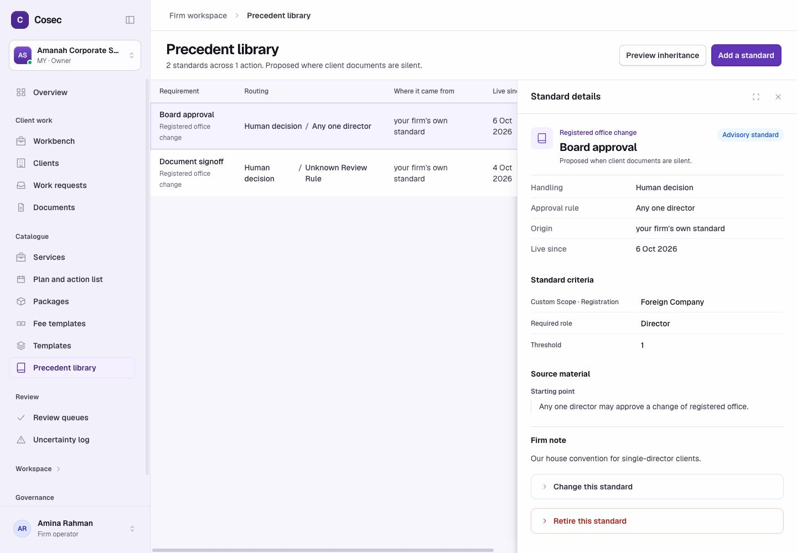
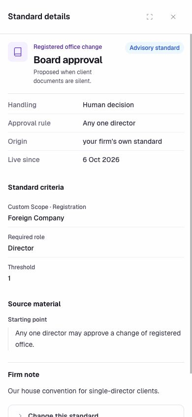
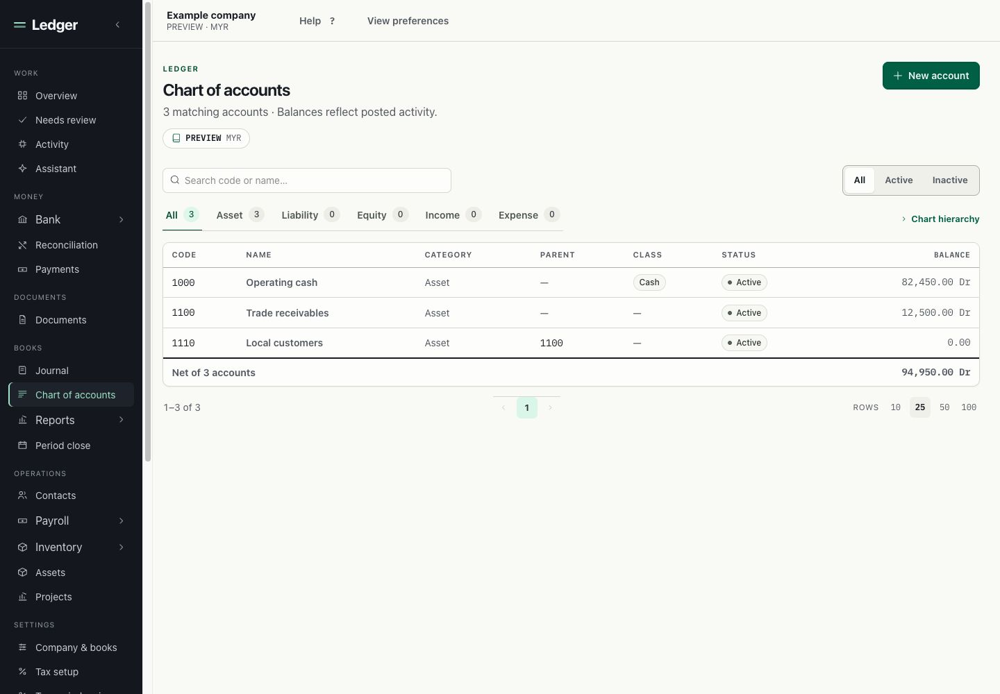
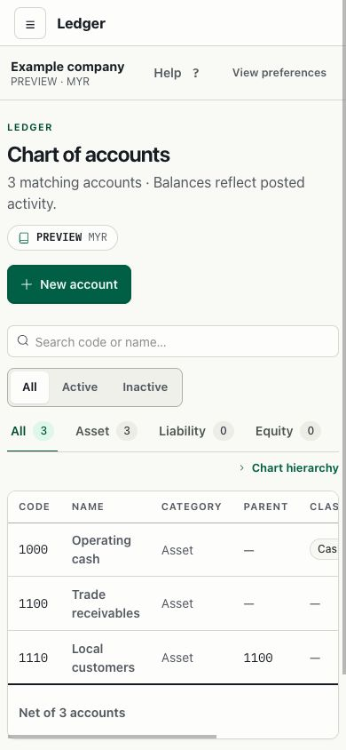
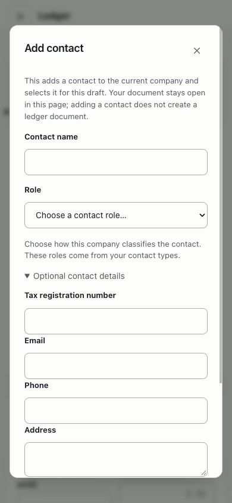

# Shared UI review and implementation — 7 October 2026

Cosec and Ledger now consume the same committed Orbital foundation. Components own their structure and default styling; applications set semantic tokens and compose domain workflows. This pass improves the working interfaces and removes duplicated component frames and skins without imposing a single product identity.

## Design and UX assessment

The starting problem was more than a plain palette. Cosec exposed implementation codes and JSON in its precedent inspector, with weak separation between criteria, source evidence and firm commentary. Ledger mixed local component CSS with library markup, and setup guidance took priority over populated account records. A page loading successfully did not prove those workflows or visual states were correct.

Cosec now uses a cool iris identity: a softly tinted workspace, firmer title hierarchy, clear selection and focus, and readable record facts. The precedent inspector separates handling, approval rule, criteria, source material and firm notes. Unknown criteria keys and routing values retain a readable display; malformed stored criteria have an explicit readable fallback, while editing retains access to the saved value. Existing version-change and retirement paths remain intact.

Ledger uses warm mineral surfaces, evergreen actions, its existing dark navigation and accounting typography. Its central page heading now delegates to Orbital PageHeader, so all PageShell consumers inherit the same hierarchy. Populated accounts put records and the New account action first; genuinely empty charts retain shared Callout guidance, with different next steps for available starters, manual creation and read-only access. Filters, balances and table density remain suitable for daily accounting work.

Motion is restrained: component state transitions and inspector/menu behavior explain changes. Reduced-motion support remains active. No decorative animation, raster assets or new animation runtime were added. Visual polish is a design judgment; this report does not claim a universal A-grade result or complete WCAG conformance.

## Ownership and sharing

| Layer | Orbital owns | Application owns |
|---|---|---|
| Foundations | Semantic token contract, component theme, focus and motion defaults | Brand/neutral palette, typography identity, density and surface token overrides |
| Common UI | Headers, fields, buttons, badges, tables, cards, callouts, record facts, disclosure, menus, state surfaces, chat primitives | Domain copy, data, routes, permissions and page composition |
| Tables | One TableShell frame, caption/empty behavior, native sort-link and explicit client-sort extension points | Columns, cell content, query conventions, runtime sorting hooks and accounting totals |
| Navigation | SidebarNav, menus, switcher and shared skin tokens | Role/book authorization, outer responsive shell, Ledger rail and per-view nested disclosure preferences |
| Interaction | Standalone inspector assets and server-rendered primitives | Asset delivery, CSP, routing and optional Alpine/LedgerUI runtime integration |

Cosec table variants delegate to TableShell rather than maintaining a second frame. Ledger removed its duplicate generic component styling and imports the shared theme through a component CSS layer, with brand tokens above it. This also exposed real cascade bugs which were fixed during browser review: active tab contrast and native-dialog sizing under Tailwind's reset.

Source-only adoption audit on the feature branches counted 541 Cosec and 826 Ledger templ component call sites, excluding generated Go and test files. These are call-site counts, not percentages of UI sharing. A single central PageHeader call in Ledger serves many pages, while Cosec wrappers expand shared field usage. Ledger retains scoped host selectors for page-header typography, navigation context, workflow composition and expanded contact-sheet sizing; the shared library remains the authority for generic component states and frames.

The outer shells remain app-owned deliberately. Ledger's nested navigation has per-user/book preferences, a compact rail and accounting-specific routing; Orbital's current SidebarNav supports flat destinations and section disclosure. Unifying those behaviors would require an explicit nested-navigation contract, rather than deleting a tested host workflow. Cosec's docked inspector and Ledger's multi-record drill stack also have different semantics. Business-specific templates are not appropriate additions to a generic library.

## Portable distribution

Both products check in an immutable snapshot of upstream commit **27a4835** under third_party/orbitalui-htmx and use a relative go.mod replacement. Their scripts/sync-orbitalui.sh archive a committed ref only; dirty and untracked upstream files cannot leak into the snapshots. PROVENANCE.md records the exact resolved SHA. This permits reproducible builds before a tagged upstream release, without machine-specific paths or an unpublished module cache.

The shared source includes nil-slot hardening for older components, CSP-safe chat composition, host table extensions, accessible switcher names, navigation skin tokens and responsive native-dialog framing. Covered optional body slots render empty wrappers without panicking. Table sorting behavior is opt-in and preserves native links, existing client hooks and query conventions.

The library's design-system documentation records the runtime boundary: ModalShell, ConfirmButton, Drawer and EntityPicker still require compatible Alpine/LedgerUI helpers; the inspector uses standalone external assets. This pass does not pretend those runtime-dependent components can be dropped into Cosec's strict CSP without integration work.

Cosec generation now runs from the repository root and excludes third_party/tmp, retaining consistent error-source paths. Ledger keeps its pinned app generator and confines generation to app templates; vendored generated source is never rewritten with Ledger's older CLI.

## Validation and limits

- Full go test ./... passes in both applications. Database-dependent cases that require opt-in are not counted as exercised by the hermetic run.
- Library race tests, vet and generation pass. Both affected app UI suites pass race/vet checks, generation checks and deterministic CSS checks. Ledger's 75 JavaScript interaction tests pass; Cosec's accessibility and UX audits pass.
- Database-backed Cosec UI/HTTP tests and Ledger UI tests additionally pass against fresh migrated disposable local databases. Cosec uses its seed data; Ledger uses its test fixtures and database-specific grants. Existing development data and login sessions were not used or changed. The disposable databases were removed after the run.
- Browser review uses production templates with synthetic fixtures, at 1440x1000 desktop and 390x844 phone sizes. Automated axe checks cover WCAG 2 A/AA, 2.1 A/AA and 2.2 AA tags on selected states. Final results are recorded in browser-audits.json; failures discovered during review were corrected and rerun.
- Cosec checks include precedent selection, malformed criteria, empty state, edit disclosure, draft retention while changing records, focus restoration, keyboard resizing, full-screen inspector, mobile navigation, company overview, officers/actions registers, firm clients, platform shell and login. Ledger checks include populated/empty accounts, invoice/payment authoring, native create dialogs, mobile navigation and focus restoration.
- Page-level horizontal overflow is checked against documentElement.clientWidth, not just innerWidth. Wide data tables intentionally scroll inside their named table region. Expanded phone dialogs are separately checked for internal horizontal clipping.
- This is not a claim that every authenticated production route was driven manually, every screen-reader workflow was tested, or every live backend mutation was submitted through the browser. Static Ledger fixtures do not serve its API/HTMX endpoints; real route behavior is covered by the application tests. No authentication bypass or development session token was created for these previews.

## Screenshots

The screenshots contain synthetic preview records and show the actual production-template components.

### Cosec precedent inspector

### Ledger account register

### Expanded Ledger contact dialog

## Git integration and preserved work

Implementation used isolated feature worktrees: feat/shared-ui-foundation for Orbital and feat/shared-ui-polish in each application. Luna agents implemented scoped changes; a GPT-6.1-sol reviewer reviewed, tested and made detailed commits. These branches are integrated into development after final verification; no remote push or release tag is part of this pass.

Original Orbital README/chat edits and untracked files remain untouched in the original feat/workspace-design-system checkout. Orbital development is available in the separate ui-foundation-library worktree so those edits do not have to be moved.

Cosec's 93 pre-existing generated-file changes were verified to contain only old FileName metadata. They are preserved in an explicitly named safety stash and a stable backup ref before merging; they are not reapplied over the corrected generation output. The backup ref, stash SHA, pre-merge base and feature heads are recorded in integration.json. No pre-existing source edits were discarded.

Cosec’s ignored local go.work previously pointed to the old original library checkout, overriding the portable module replacement. Its original bytes are preserved as a Git blob at refs/backup/pre-ui-foundation-go-work; the workspace now uses . and ./third_party/orbitalui-htmx while retaining Go 1.26.2. To restore the original configuration from the Cosec repository, run `git show refs/backup/pre-ui-foundation-go-work > go.work`. Default go build ./... resolves the committed snapshot and passes. Air delegates template generation to task templ, which reports zero updates and excludes the vendored library.
